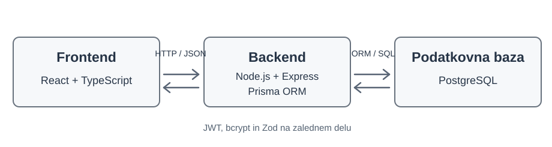

# Arhitektura in tehnološki sklad

## Arhitektura

Aplikacija bo sestavljena iz treh glavnih delov:

* **Frontend:** Uporabniški vmesnik za pregled urnikov in upravljanje zahtev.
* **Backend:** REST API, ki obdeluje zahteve, preverja pravice uporabnikov in izvaja poslovno logiko.
* **Podatkovna baza:** Shranjevanje uporabnikov, izmen, zahtev za menjavo in nerazpoložljivosti.

Frontend bo z backendom komuniciral prek HTTP zahtev v formatu JSON. Backend bo dostopal do podatkovne baze in preverjal veljavnost operacij.

## Diagram arhitekture

## Tehnološki sklad

* **Frontend:** React, TypeScript, CSS
* **Backend:** Node.js, Express, TypeScript
* **Podatkovna baza:** PostgreSQL
* **ORM:** Prisma
* **Avtentikacija:** JWT, bcrypt
* **Validacija podatkov:** Zod
* **Lokalni razvoj:** Node.js, npm, Docker Compose
* **Verzioniranje:** Git in GitHub

## Avtentikacija

Uporabniki se prijavijo z elektronskim naslovom in geslom. Backend ob uspešni prijavi izda JWT žeton. Dostop do posameznih funkcionalnosti se preverja glede na uporabniško vlogo z uporabo Express middleware funkcij. Gesla so v podatkovni bazi shranjena v zgoščeni obliki z uporabo bcrypt.

## Lokalni zagon

Podatkovna baza PostgreSQL se zažene z Docker Compose, backend z ukazom `npm run dev` v mapi backend, frontend pa z enakim ukazom v mapi frontend.

## Arhitekturne odločitve

* **React:** Omogoča izdelavo dinamičnega uporabniškega vmesnika.
* **Node.js in Express:** Omogočata enostaven razvoj REST API-ja in uporabo TypeScripta na obeh straneh aplikacije.
* **PostgreSQL:** Primeren za povezane podatke, kot so uporabniki, izmene in zahteve.
* **Prisma:** Poenostavi delo s podatkovno bazo in upravljanje podatkovnega modela.
* **JWT:** Omogoča avtentikacijo uporabnikov, medtem ko backend preverja njihove pravice.
* **Docker Compose:** Poenostavi lokalni zagon podatkovne baze.
