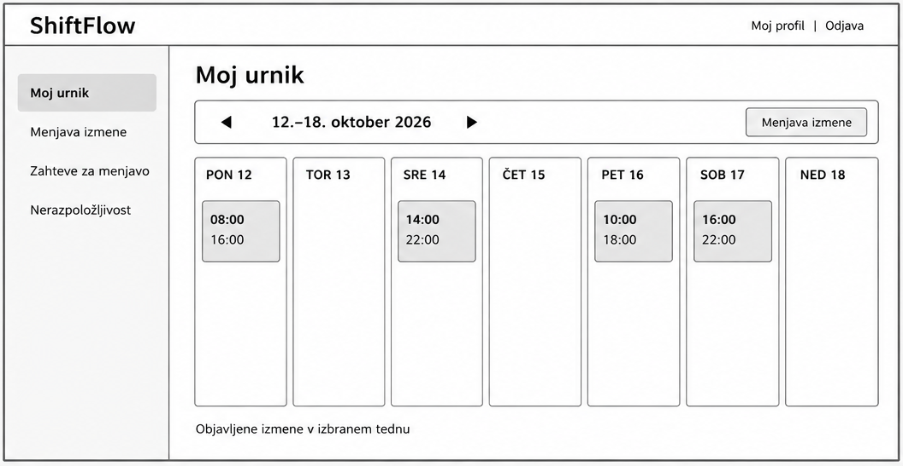
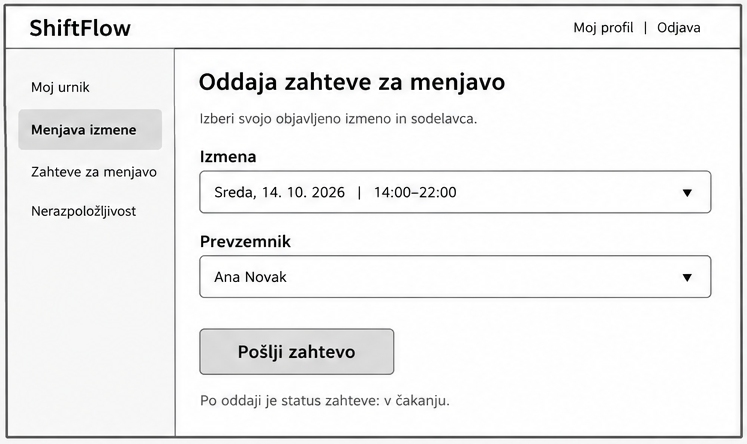
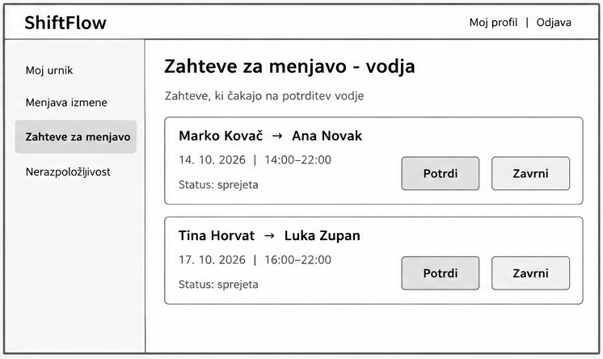

# Wireframe-i – ShiftFlow

Spodnje skice prikazujejo osnovne zaslone aplikacije in ključni proces menjave izmene. Gre za začetni predlog uporabniškega vmesnika, ne za končno oblikovanje.

## 1. Pregled delovnih izmen

Zaposleni vidi svoje objavljene izmene po dnevih in lahko preklaplja med tedni. Na voljo ima tudi povezavo do oddaje zahteve za menjavo (US-03, US-05).

## 2. Oddaja zahteve za menjavo

Zaposleni izbere svojo izmeno in sodelavca, ki bi jo lahko prevzel. Po oddaji zahteva dobi status »v čakanju« (US-05).

## 3. Potrditev menjave – vodja izmen

Vodja vidi zahteve, ki jih je sodelavec že sprejel, in jih potrdi ali zavrne. Sistem pred potrditvijo preveri prekrivanje izmen in nerazpoložljivost (US-07).
